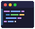
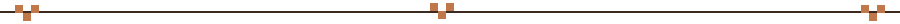
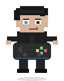
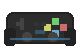

<p align="center">
  
</p>

<!-- HERO SECTION WITH CODER + FLOATING STICKERS -->
<table align="center" border="0" cellspacing="0" cellpadding="0">
  <tr>
    <td align="center" width="120" style="border:none;">
      
    </td>
    <td align="center" width="180" style="border:none;">
      
    </td>
    <td align="center" width="120" style="border:none;">
      
    </td>
  </tr>
</table>

<h3 align="center">
  
</h3>

<p align="center">
  
  
  
  
</p>

<p align="center">
  <i>Not just writing code. Building experiences — fueled by coffee. ☕</i>
</p>



## ◈ ABOUT ME

Hey, I'm **Muhammad Wasay**.  
I'm a **Full Stack Developer**, **CSIT undergraduate at NED University**, and an **indie game development enthusiast**.

I enjoy building software, engineering machine learning systems, and creating interactive worlds. From web applications to game levels, I love turning ideas into something people can actually use and enjoy.

```js
const wasay = {
  identity:        "WASAY.exe",
  role:            "Full Stack Developer & ML Engineer",
  education:       "CSIT @ NED University (NEDUET)",
  fuel:            "Coffee ☕",
  gameDevelopment: {
    engine:     "Godot",
    genres:     "Indie Games",
    dimensions: ["2D", "3D"]
  },
  philosophy: "Build. Code. Play. Repeat."
};
```


## ◈ CURRENT QUEST

<table align="center" width="100%">
  <tr>
    <td width="65%" valign="middle">

| QUEST | STATUS | PROGRESS |
| :--- | :---: | :--- |
| **Full Stack & ML Engineering** | 🟢 IN PROGRESS | `████████░░ 80%` |
| **Indie Game Development** | 🟢 IN PROGRESS | `███████░░░ 70%` |
| **2D Game Worlds (Godot)** | 🔵 EXPLORING | `██████░░░░ 60%` |
| **3D Game Worlds (Godot)** | 🔵 EXPLORING | `█████░░░░░ 50%` |
| **Building Meaningful Projects** | ♾️ ALWAYS ON | `██████████ 100%` |

  </td>
    <td width="35%" align="center" valign="middle">
      <br/>
      <sub><i>Every project is another level unlocked.</i></sub>
    </td>
  </tr>
</table>


## ◈ FEATURED PROJECT

<p align="center">
  
</p>

### 🚗 KaarWala — ML Fair Market Price Engine

> *A production-grade Machine Learning system for predicting fair used-car prices in Pakistan.*

Trained on **10,589 verified listings** and benchmarked on **83 live OLX Pakistan ads**, achieving **97.75% R²** and **8.55% MAPE** in real-world testing.

<p align="center">
  
  
  
  
</p>

<p align="center">
  <a href="https://github.com/Muhammad-wasay/KaarWala">
    
  </a>
  <a href="https://kaarwala.streamlit.app/">
    
  </a>
</p>


## ◈ GAME DEVELOPMENT LAB

<table align="center" width="100%">
  <tr>
    <td width="35%" align="center" valign="middle">
      <br/>
      
    </td>
    <td width="65%" valign="middle">
      <h3>A different kind of playground. 🎮</h3>
      <p>I enjoy creating indie games and exploring the world of interactive entertainment. Turning concepts into playable worlds with Godot Engine.</p>
      <p>
        
        
        
        
      </p>
      <pre>
IDEA ──▶ DESIGN ──▶ BUILD ──▶ PLAY ──▶ REFINE ──▶ REPEAT
[ Game worlds loading... ] ████████░░ 80%
      </pre>
    </td>
  </tr>
</table>


## ◈ TECH ARSENAL

<p align="center">
  
</p>

<p align="center">
  <i>One tool at a time. One skill at a time. Always evolving.</i>
</p>


## ◈ GITHUB STATISTICS *(Coffee Edition ☕)*

<p align="center">
  
  
</p>

<p align="center">
  
</p>


## ◈ CONTRIBUTION MAP & SNAKE ARENA 🐍

<p align="center">
  
</p>

<p align="center">
  <picture>
    <source media="(prefers-color-scheme: dark)" srcset="https://raw.githubusercontent.com/Muhammad-wasay/Muhammad-wasay/output/github-contribution-grid-snake-dark.svg" />
    <source media="(prefers-color-scheme: light)" srcset="https://raw.githubusercontent.com/Muhammad-wasay/Muhammad-wasay/output/github-contribution-grid-snake.svg" />
    
  </picture>
</p>


## ◈ PLAYER PROFILE

<p align="center">
  
  
  
</p>

```text
Achievement unlocked:
[✓] Started building
[✓] Explored software development & ML
[✓] Entered the indie game development world
[✓] Shipped KaarWala (97.75% R² • 83 Live OLX Ads)
[ ] Create unforgettable experiences
[ ] Build something legendary

NEXT LEVEL: IN PROGRESS...
```


## ◈ LET'S CONNECT

<p align="center">
  <a href="https://github.com/Muhammad-wasay">
    
  </a>
  <a href="https://www.linkedin.com/in/muhammad-wasay-rafiq">
    
  </a>
  <a href="mailto:wasayrafiq6@gmail.com">
    
  </a>
</p>


<!-- SLEEPING DEVELOPER + COFFEE FOOTER -->
<p align="center">
  
</p>

<h3 align="center">BUILD. CODE. PLAY. SLEEP.</h3>

<p align="center">
  <i>Repeat until legendary. ☕✨</i>
</p>

<p align="center">
  
</p>
