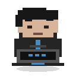

<p align="center">

</p>

<p align="center">

</p>

<h3 align="center">

</h3>

<p align="center">


</p>

<p align="center">
<i>Not just writing code. Building experiences.</i>
</p>


## ◈ ABOUT ME

Hey, I'm **Muhammad Wasay**.

I'm a **Full Stack Developer**, CSIT undergraduate at **NED University**, and an indie game development enthusiast.

I enjoy building software, exploring technology, and creating interactive experiences.
From web applications to game worlds, I love the process of turning ideas into something people can actually use and experience.

```js
const wasay = {
  role:            "Full Stack Developer",
  education:       "CSIT @ NEDUET",
  gameDevelopment: {
    engine:     "Godot",
    genres:     "Indie Games",
    dimensions: ["2D", "3D"]
  },
  philosophy: "Build. Code. Play. Repeat."
};
```


## ◈ CURRENT QUEST

<p align="center">

</p>

| QUEST | STATUS |
| :--- | :---: |
| Full Stack Development | 🟢 IN PROGRESS |
| Indie Game Development | 🟢 IN PROGRESS |
| 2D Game Development | 🔵 EXPLORING |
| 3D Game Development | 🔵 EXPLORING |
| Building meaningful projects | ♾️ ALWAYS ON |

> *Every project is another level unlocked.*


## ◈ FEATURED PROJECT

<p align="center">

</p>

### 🚗 KaarWala — ML Fair Market Price Engine

> *A project I want you to explore.*

KaarWala is a production-grade Machine Learning system for predicting fair used-car prices in Pakistan. Trained on **10,589 verified listings**, benchmarked on **83 live OLX ads** with a real-world accuracy of **97.75% R²** and **8.55% MAPE**.

<p align="center">


</p>

<p align="center">
<a href="https://github.com/Muhammad-wasay/KaarWala">

</a>
<a href="https://kaarwala.streamlit.app/">

</a>
</p>


## ◈ GAME DEVELOPMENT LAB

<p align="center">

</p>

*A different kind of playground.*

I also enjoy creating indie games and exploring the world of interactive entertainment.
My game development interests include:

<p align="center">


</p>

The creative loop:

```
IDEA  ↓  DESIGN  ↓  BUILD  ↓  PLAY  ↓  REFINE  ↓  REPEAT
```

> *I'm interested in building interactive worlds, experimenting with gameplay, and bringing original ideas to life.*

```
[ Game worlds loading... ] ████████░░ 80%
```


## ◈ TECH ARSENAL

<p align="center">

</p>

<p align="center">
<i>One tool at a time. One skill at a time. Always evolving.</i>
</p>


## ◈ GITHUB STATISTICS

<p align="center">


</p>

<p align="center">

</p>


## ◈ CONTRIBUTION MAP

<p align="center">

</p>

<p align="center">

</p>


## ◈ PLAYER PROFILE

<p align="center">


</p>

```
Achievement unlocked:
[✓] Started building
[✓] Explored software development
[✓] Entered the game development world
[✓] Shipped KaarWala (97.75% R² • 83 Live OLX Ads)
[ ] Create unforgettable experiences
[ ] Build something legendary

NEXT LEVEL: IN PROGRESS...
```


## ◈ LET'S CONNECT

<p align="center">
<a href="https://github.com/Muhammad-wasay">

</a>
<a href="https://www.linkedin.com/in/muhammad-wasay-rafiq">

</a>
<a href="mailto:wasayrafiq6@gmail.com">

</a>
</p>


<p align="center">

</p>

<h3 align="center">BUILD. CODE. PLAY.</h3>

<p align="center">
<i>Repeat until legendary.</i>
</p>

<p align="center">

</p>
